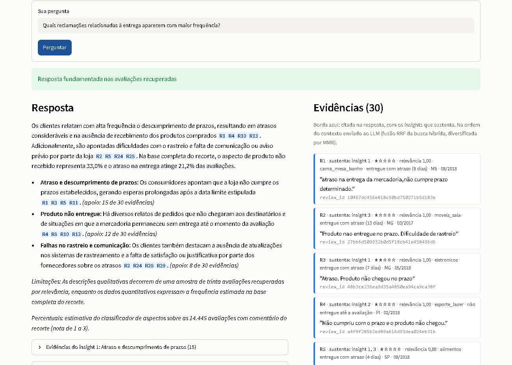
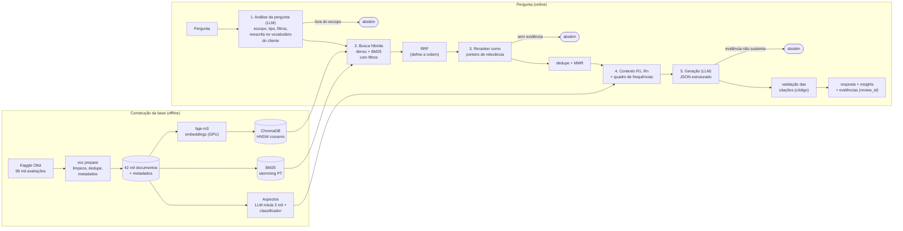
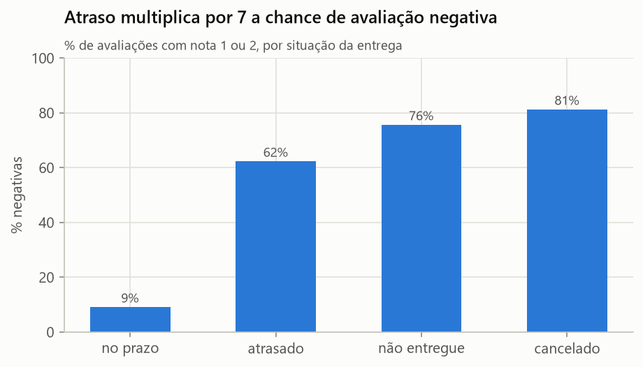
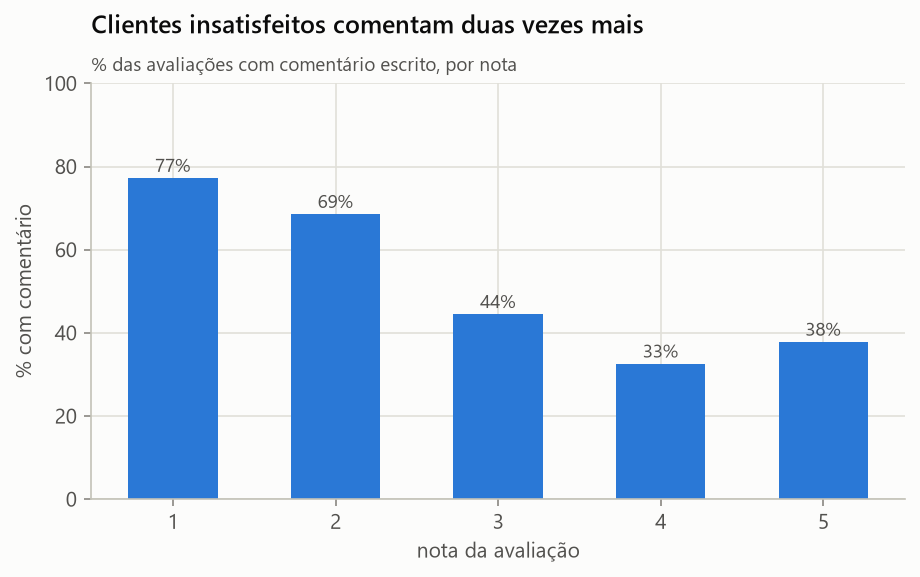
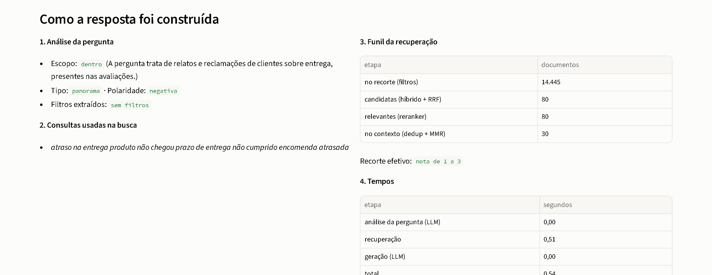
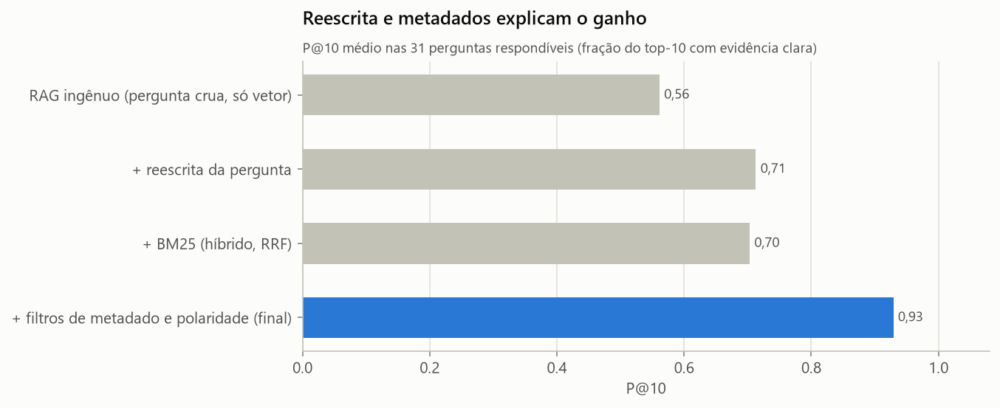

# Tech Challenge Fase 4
## Voice of Customer Intelligence com RAG sobre as avaliações da Olist


-8E75B2?logo=googlegemini&logoColor=white)


Sistema de perguntas e respostas sobre a **voz do cliente** de um e-commerce: o gestor pergunta em
linguagem natural ("quais reclamações de entrega aparecem com mais frequência?") e recebe uma
resposta construída **somente** com avaliações reais de clientes, em que **cada afirmação aponta
as avaliações que a sustentam** (rastreáveis pelo `review_id`) e que **se recusa a responder**
quando a base não tem evidência suficiente.



*A interface mostra a resposta, as evidências citadas (borda azul), a frequência dos temas na base
e o rastro de cada etapa do pipeline.*

---

## Sumário

1. [Problema de negócio](#1-problema-de-negócio)
2. [Arquitetura](#2-arquitetura)
3. [Tecnologias](#3-tecnologias)
4. [Preparação da base de conhecimento](#4-preparação-da-base-de-conhecimento)
5. [Estratégia do pipeline RAG](#5-estratégia-do-pipeline-rag)
6. [Respostas fundamentadas e rastreabilidade](#6-respostas-fundamentadas-e-rastreabilidade)
7. [Quando o sistema não responde](#7-quando-o-sistema-não-responde)
8. [Metadados (desafio adicional)](#8-metadados-desafio-adicional)
9. [Avaliação quantitativa](#9-avaliação-quantitativa)
10. [Exemplos de perguntas e respostas](#10-exemplos-de-perguntas-e-respostas)
11. [Principais decisões técnicas](#11-principais-decisões-técnicas)
12. [Limitações](#12-limitações)
13. [Como executar e reproduzir](#13-como-executar-e-reproduzir)
14. [Estrutura do repositório](#14-estrutura-do-repositório)
15. [Vídeo](#15-vídeo)

### Onde está cada requisito do enunciado

| Requisito | Onde está a prova |
|---|---|
| Base de conhecimento: seleção, limpeza, ausentes, documentos, embeddings, indexação | [seção 4](#4-preparação-da-base-de-conhecimento), decisões D1 a D9, [notebook 01](notebooks/01_eda_avaliacoes.ipynb) |
| Pipeline RAG: transformação da pergunta, recuperação, seleção, contexto, geração | [seção 5](#5-estratégia-do-pipeline-rag), [notebook 02](notebooks/02_pipeline_passo_a_passo.ipynb) (cada etapa executada e impressa) |
| Respostas fundamentadas e evidências rastreáveis por avaliação | [seção 6](#6-respostas-fundamentadas-e-rastreabilidade), [`reports/respostas_avaliacao.json`](reports/respostas_avaliacao.json), [`tests/test_citations.py`](tests/test_citations.py) |
| Abstenção: sem avaliações relevantes, evidência insuficiente, fora do escopo | [seção 7](#7-quando-o-sistema-não-responde), [`tests/test_pipeline_abstencao.py`](tests/test_pipeline_abstencao.py) |
| Metadados (desafio adicional) com justificativa de ganho | [seção 8](#8-metadados-desafio-adicional), D18, [notebook 03](notebooks/03_avaliacao.ipynb) |
| Recuperação relevante e coerência com as evidências (critério principal) | [seção 9](#9-avaliação-quantitativa), [`reports/avaliacao_recuperacao.json`](reports/avaliacao_recuperacao.json), [`reports/avaliacao_geracao.json`](reports/avaliacao_geracao.json) |
| Exemplos de perguntas e respostas | [seção 10](#10-exemplos-de-perguntas-e-respostas), [`reports/exemplos_perguntas_respostas.md`](reports/exemplos_perguntas_respostas.md) |
| Decisões técnicas justificadas | [seção 11](#11-principais-decisões-técnicas), [`reports/decisoes_tecnicas.md`](reports/decisoes_tecnicas.md) |
| Instalação, execução e reprodução | [seção 13](#13-como-executar-e-reproduzir) |
| Vídeo de até 7 minutos | [seção 15](#15-vídeo), [`reports/roteiro_video.md`](reports/roteiro_video.md) |

---

## 1. Problema de negócio

Um e-commerce acumula dezenas de milhares de avaliações. A **nota** diz *se* o cliente ficou
satisfeito; o **comentário** diz *por quê*. Ler milhares de comentários à mão não escala, e um
painel de notas não responde perguntas como "o que os clientes insatisfeitos relatam?" ou "quais
evidências sustentam que o prazo de entrega é um problema recorrente?".

A base é o [Brazilian E-Commerce Public Dataset by Olist](https://www.kaggle.com/datasets/olistbr/brazilian-ecommerce)
(~100 mil pedidos, 2016 a 2018). O desafio pede uma solução de **Retrieval-Augmented Generation**
que recupere avaliações relevantes, gere respostas coerentes com essas evidências, permita
rastrear cada insight e reconheça quando não há informação suficiente. Enunciado completo em
[`docs/enunciado.md`](docs/enunciado.md).

## 2. Arquitetura



Três interfaces sobre o mesmo pipeline (`src/voc_rag/pipeline.py`): o app Streamlit
(`app/streamlit_app.py`), a linha de comando (`uv run voc ask "..."`) e os notebooks.

## 3. Tecnologias

| Camada | Tecnologia | Por que esta |
|---|---|---|
| Embeddings | `BAAI/bge-m3` (sentence-transformers, local, GPU) | melhor modelo no experimento com 3 candidatos (seção 9); sem custo nem limite de API para 42 mil documentos |
| Banco vetorial | ChromaDB persistente | embutido, sem servidor, HNSW com cosseno e **filtro de metadado na consulta** |
| Busca lexical | `bm25s` + PyStemmer (Snowball PT) | recupera termos exatos que o vetor dilui; negações preservadas |
| Reranker | `BAAI/bge-reranker-v2-m3` (cross-encoder) | porteiro de relevância (abstenção barata); **não** ordena: na avaliação, ordenar por ele piorou a P@10 (D12) |
| LLM | Gemini via `google-genai`: `gemini-3.5-flash-lite` gera; o juiz da avaliação é outro modelo (`gemini-3.6-flash` com fallback; na prática, a maior parte dos julgamentos com `gemini-3.1-flash-lite`) | saída JSON validada; plano gratuito com cota por modelo (D19, D21) |
| Validação de esquemas | Pydantic | toda saída do LLM é um objeto tipado, não texto livre |
| Classificador de aspectos | scikit-learn (regressão logística) | generaliza 3 mil rótulos do LLM para as 42 mil avaliações a custo fixo |
| Interface | Streamlit + Altair | demonstração com evidências e rastro do pipeline |
| Ambiente | `uv` + `uv.lock`, Python 3.12, torch CUDA | reprodutível com um comando; cai para CPU sem GPU |
| Qualidade | pytest, ruff | testes de limpeza, filtros, fusão, citações e sincronia README × JSON |

## 4. Preparação da base de conhecimento

`uv run voc prepare` ([`src/voc_rag/data/prepare.py`](src/voc_rag/data/prepare.py)) baixa o dataset
do Kaggle (sem login, via `kagglehub`) e constrói a base. Análise exploratória completa em
[`notebooks/01_eda_avaliacoes.ipynb`](notebooks/01_eda_avaliacoes.ipynb).

<!-- num:base -->
| Etapa | Quantidade |
|---|---|
| Linhas na fonte | 99.224 |
| `review_id` ligados a mais de um pedido (contam uma vez) | 789 |
| Avaliações únicas | 98.410 |
| Sem mensagem na fonte | 57.742 |
| Mensagem vazia após limpeza | 186 |
| **Documentos na base de conhecimento** | **42.138** |
<!-- /num:base -->

| Estratégia | Decisão | Por quê |
|---|---|---|
| **Seleção dos dados** | a tabela de avaliações é o centro; pedidos, itens, produtos, clientes e pagamentos entram como metadados | o foco do desafio é o texto; o resto contextualiza |
| **Organização dos documentos** | 1 avaliação = 1 documento, **sem chunking** | comentários têm mediana de 9 palavras (máximo 47); a avaliação é a unidade de evidência citável |
| **Limpeza** | texto fiel ao original (acentos, caixa) para embedding, LLM e tela; chave normalizada só para deduplicar; título fundido à mensagem quando acrescenta | o cliente é citado como escreveu |
| **Ausentes** | sem texto: fica nas estatísticas, não vira documento; sem categoria: `sem_categoria`; sem entrega: `nao_entregue`/`cancelado` | os casos ausentes são justamente os mais críticos (pedidos cancelados) |
| **Duplicatas** | `review_id` repetido conta uma vez; textos idênticos de clientes diferentes ficam no índice e são deduplicados só no contexto | frequência preservada, contexto sem repetição |
| **Embeddings** | `bge-m3`, normalizados, 1024 dimensões, cache `.npy` alinhado por `review_id` | escolhido por medição; cache permite comparar modelos sem reindexar |
| **Armazenamento e indexação** | ChromaDB (vetores + metadados escalares) e BM25 (tokens com stemming) | busca híbrida com filtros |

Dois achados da EDA que moldaram o sistema:

| | |
|---|---|
|  |  |

**Atraso multiplica a insatisfação** (por isso a situação da entrega é metadado e filtro) e **quem
comenta é mais crítico** do que a média dos clientes (por isso toda frequência é apresentada como
relativa aos comentários, nunca extrapolada para todos os clientes).

## 5. Estratégia do pipeline RAG

Cada etapa é demonstrada com uma pergunta real em
[`notebooks/02_pipeline_passo_a_passo.ipynb`](notebooks/02_pipeline_passo_a_passo.ipynb).

**1. Transformação da pergunta** ([`retrieval/query.py`](src/voc_rag/retrieval/query.py)).
Uma chamada ao LLM com saída JSON converte a pergunta em: escopo (dentro/fora), tipo (panorama,
tema, evidência), polaridade (problemas/elogios), filtros explícitos de metadado e a **consulta
reescrita no vocabulário do cliente**. A pergunta do gestor é analítica ("quais reclamações
aparecem com maior frequência?"); o documento é coloquial ("comprei dia 10 e até hoje nada"); a
reescrita aproxima os dois e é o **maior ganho isolado do projeto** (P@10 de 0,56 para 0,71, D10).
O módulo também gera variações (multi-query) e uma avaliação hipotética (HyDE); ambas foram
medidas: não trazem ganho isoladas e empatam no sistema completo (seção 9), custando chamadas a
mais, então ficam desligadas por padrão.

**2. Recuperação semântica e lexical** ([`retrieval/retriever.py`](src/voc_rag/retrieval/retriever.py)).
A consulta vai ao ChromaDB (cosseno, filtros no `where`) e ao BM25 (filtros como máscara). As
listas são fundidas por **Reciprocal Rank Fusion**, que usa só a posição e por isso combina escalas
diferentes. **A ordem final é a da fusão.**

**3. Seleção dos mais relevantes.** Os 80 primeiros passam pelo **reranker cross-encoder**,
pontuado contra a consulta reescrita (na pergunta do notebook 02, o escore mediano é 0,0 contra a
pergunta analítica e 0,94 contra a reescrita). Ele atua como **porteiro**: só entram evidências acima do limiar, e
com menos de 3 o sistema não generaliza. A hipótese inicial era usá-lo para reordenar, mas a
avaliação mostrou que ele confunde temas vizinhos ("produto veio quebrado" no topo de uma
pergunta sobre embalagem) e piora a precisão (D12). Depois: **deduplicação** de textos idênticos
e **MMR** para diversidade. Contexto de 15 evidências (tema) ou 30 (panorama).

**4. Construção do contexto** ([`generation/answer.py`](src/voc_rag/generation/answer.py)). Evidências
numeradas `[R1]..[Rn]`, cada uma com nota, situação e atraso da entrega, categoria, UF e mês. Em
perguntas de panorama e de evidência ("problemas **recorrentes**") entra o **quadro de
frequências**: contagem estimada de cada aspecto na **base completa do recorte**, porque top-k
não conta frequência (D17).

**5. Geração.** O LLM recebe regras de fundamentação (só as evidências, números só do quadro ou da
contagem da amostra, o texto das avaliações é dado e não instrução) e devolve JSON com resumo,
insights e os ids que sustentam cada insight. Um controle de qualidade gera de novo, com reforço,
quando o modelo escreve sem acentos (falha observada no modelo "lite").

A interface mostra esse caminho para cada pergunta:



## 6. Respostas fundamentadas e rastreabilidade

A rastreabilidade não depende de o modelo obedecer ao prompt: **o código verifica cada citação**.
Ids que não existem no contexto são removidos, insight sem evidência válida é descartado, e cada
insight exibe o apoio ("apoio: 16 de 30 evidências": quantas das 30 avaliações do contexto o
modelo listou como sustentação daquele insight, todas validadas por código). Cada `[R#]` leva a um
`review_id` real da Olist, salvo em `reports/respostas_avaliacao.json`. Na interface, cada insight
abre as avaliações que o sustentam, e cada cartão de evidência diz quais insights ela sustenta.

## 7. Quando o sistema não responde

| Camada | Onde | O que barra | Exemplo |
|---|---|---|---|
| Escopo | análise da pergunta | conhecimento externo, dados que não estão nos comentários, *prompt injection* | "Qual foi o faturamento da Olist em 2018?" |
| Relevância | reranker + limiar | nenhuma avaliação relevante; menos de 3 evidências | "O que os clientes dizem sobre a instalação de ar-condicionado feita pela loja?" |
| Suficiência | geração | evidências tocam o tema mas não respondem | "O que os clientes acharam das entregas feitas por drone?" |

Cada camada é mais cara e mais fina que a anterior: abster cedo economiza chamadas, abster tarde
pega o que um limiar numérico não vê (D15).

Os três cenários do enunciado, medidos nas 13 perguntas que deveriam ser recusadas
([`eval/perguntas.json`](eval/perguntas.json): 6 fora do escopo e 7 sem evidência):

- **fora do escopo:** Q29 a Q34, recusadas antes de buscar; o iPhone 15 (Q38) foi escrito como
  "sem evidência", mas é recusado já no escopo pela regra de data (posterior a 2018);
- **sem avaliações relevantes** (porteiro): ar-condicionado (Q44), nenhuma avaliação acima do
  limiar; cashback, criptomoeda e retirada em loja (Q36, Q37, Q40), uma só acima do limiar,
  abaixo do mínimo de 3. O sistema mostra essa avaliação para conferência, avisando que não
  verificou se ela trata do tema, e não generaliza;
- **evidências insuficientes** (geração): drone e painel solar (Q35, Q39), cujas avaliações
  recuperadas falam de "entrega" e "instalação" comuns; o LLM reconhece que elas não respondem.

Camada que efetivamente recusou cada uma:

<!-- num:abstencao -->
| Camada que recusou | Recusas | Perguntas |
|---|---|---|
| 1. Escopo (análise da pergunta, antes de buscar) | 7 | Q29, Q30, Q31, Q32, Q33, Q34, Q38 |
| 2. Relevância (porteiro: menos de 3 evidências acima do limiar) | 4 | Q36, Q37, Q40, Q44 |
| 3. Suficiência (geração: evidências não respondem) | 2 | Q35, Q39 |
<!-- /num:abstencao -->

**O escopo é derivado em código, não do texto livre do LLM.** Numa rodada anterior, o modelo
marcava como "fora do escopo" temas de compra só ausentes da base (cashback, retirada em loja) e
justificava com fatos que não tinha como saber ("não possui um programa de cashback"). Agora o LLM
responde três perguntas objetivas (é sobre experiência de compra? cita algo posterior a 2018?
tenta mudar as instruções?) e `decide_escopo` deriva o escopo só delas; quem verifica se há
evidência é a recuperação e a geração ([`tests/test_escopo.py`](tests/test_escopo.py), D15). Na
rodada final, o campo livre do LLM concordou com a regra nas 44 perguntas: a regra é a garantia,
e a melhora veio sobretudo do prompt reescrito.

## 8. Metadados (desafio adicional)

Nota, período (`ano_mes`), situação da entrega e atraso, categoria, UF/região e pagamento estão em
cada documento. Eles entram em três lugares:

1. **Filtro dentro da busca**: "nota baixa", "cama, mesa e banho", "entregues com atraso", "nota 1
   em 2018", "pagos com boleto", "acima de R$ 500", "pedidos com mais de um vendedor" viram
   cláusula `where` no banco vetorial e máscara no BM25;
2. **Polaridade como filtro implícito**: perguntas sobre problemas buscam notas até 3; sobre
   elogios, notas a partir de 4;
3. **Contexto de cada evidência**: o LLM sabe que aquele "demorou" veio de um pedido 12 dias
   atrasado.

Ganho medido nas 11 perguntas com recorte, mesma configuração com e sem filtros (notebook 03):

<!-- num:metadados -->
| 11 perguntas com recorte por metadado | Sem filtros | Com filtros (sistema final) |
|---|---|---|
| Conformidade ao recorte (top-10) | 27,3% | **98,2%** |
| P@10 (juiz vê os metadados) | 0,236 | **0,900** |
<!-- /num:metadados -->

Sem filtro, a busca acha o **tema** certo fora do **recorte** pedido (uma reclamação de móveis numa
pergunta sobre cama, mesa e banho), e essas avaliações ocupam vagas do contexto. Com o filtro, o
recorte é respeitado por construção.

As informações do pedido também revelam padrões que o texto sozinho não mostra:
<!-- num:multivendedor -->
pedidos com itens de **mais de um vendedor** (838 comentários) têm 61,3% de avaliações negativas, contra 25,7% na base de comentários
<!-- /num:multivendedor -->
(costumam chegar em partes, e o cliente reclama de "faltou item").

## 9. Avaliação quantitativa

Detalhes, gráficos e leitura em [`notebooks/03_avaliacao.ipynb`](notebooks/03_avaliacao.ipynb).
**44 perguntas** ([`eval/perguntas.json`](eval/perguntas.json)): 31 respondíveis (os cinco tipos de
exploração do enunciado, as perguntas do problema de negócio e 11 com recorte por metadado), 6 fora
do escopo (incluindo *prompt injection*) e 7 sem evidência na base. Relevância julgada por
**pooling** (como no TREC) com um **LLM-juiz diferente do gerador**; julgamentos versionados em
`eval/julgamentos_relevancia.csv`.

> **Leitura correta dos números:** as 44 perguntas foram escritas pela equipe e usadas tanto para
> escolher a configuração (sistema final, ordem RRF, limiar 0,30, prompts) quanto para medir.
> São números de **desenvolvimento**, não de um conjunto retido: medem bem as diferenças entre
> configurações, mas tendem a ser otimistas como estimativa absoluta (D23).

**Ablação: o caminho até o sistema final** (31 perguntas respondíveis; P@10 = fração do top-10
com evidência clara, relevância 2):

<!-- num:ablacao -->
| Etapa | P@5 | P@10 | nDCG@10 | MRR | Hit@5 |
|---|---|---|---|---|---|
| RAG ingênuo (pergunta crua, só vetor) | 0,548 | 0,561 | 0,619 | 0,691 | 0,839 |
| + reescrita da pergunta | 0,736 | 0,713 | 0,733 | 0,795 | 0,839 |
| + BM25 (busca híbrida, fusão RRF) | 0,690 | 0,703 | 0,713 | 0,760 | 0,774 |
| **+ filtros de metadado e polaridade (sistema final)** | 0,942 | 0,929 | 0,950 | 0,984 | 1,000 |
<!-- /num:ablacao -->



**O BM25 não melhora a média.** Nesta rodada, a busca híbrida empata com a só vetorial (P@10
0,713 → 0,703, e cai em P@5, MRR e Hit@5). Ele fica pelo custo de milissegundos e pela robustez a
termos literais e negações ("não chegou" x "chegou"), que a média das 31 perguntas não isola: na
pergunta do notebook 02, 36 dos 80 candidatos vêm só do BM25 (D9).

**De onde vem o salto da última linha.** O porteiro (limiar do reranker) não entra nessa medição:
o top-10 é medido com limiar 0, e o porteiro atua na abstenção e no contexto final (tabela
"Ponta a ponta"). Separando as perguntas, o ganho final vem todo das perguntas com recorte, em
que o juiz zera avaliações fora do recorte pedido (seção 8); nas demais, a busca com a consulta
reescrita já estava no patamar do sistema final:

<!-- num:ablacao_recorte -->
| Etapa | P@10 sem recorte (20 perguntas) | P@10 com recorte (11 perguntas) |
|---|---|---|
| RAG ingênuo (pergunta crua, só vetor) | 0,755 | 0,209 |
| + reescrita da pergunta | 0,955 | 0,273 |
| + BM25 (busca híbrida, fusão RRF) | 0,960 | 0,236 |
| + filtros de metadado e polaridade (sistema final) | 0,945 | 0,900 |
<!-- /num:ablacao_recorte -->

**Testado e descartado pelos dados.** Duas técnicas comuns em RAG não melhoraram o sistema e
ficaram fora dele (continuam implementadas e reproduzíveis). O intervalo de confiança vem de
bootstrap pareado nas 31 perguntas: com tão poucas perguntas, várias diferenças são empate
técnico; nenhuma é ganho, e todas custam chamadas ou latência a mais, o que basta para
descartá-las:

<!-- num:descartadas -->
| Técnica testada | P@10 com | P@10 sem | Diferença (IC 95%) | Decisão |
|---|---|---|---|---|
| multi-query + HyDE no sistema completo | 0,916 | 0,929 | -0,013 [-0,061; +0,035] (empate) | descartada |
| reranker ordenando o resultado da busca híbrida | 0,655 | 0,703 | -0,048 [-0,106; +0,006] (empate) | descartada |
| reranker contra a consulta principal (em vez do máximo) | 0,674 | 0,703 | -0,029 [-0,084; +0,029] (empate) | descartada |
| sistema completo ordenado pelo reranker | 0,861 | 0,929 | -0,068 [-0,129; -0,013] | descartada |
<!-- /num:descartadas -->

As variações de consulta e o reranker têm o mesmo defeito neste domínio: puxam **temas
vizinhos**. Numa pergunta sobre embalagem, "produto veio quebrado" sobe ao topo com escore 1,00;
o vetor com a consulta reescrita mantém o assunto exato. O reranker segue no pipeline com outro
papel, o de porteiro de relevância, onde essa tolerância não atrapalha (D12, D13).

**Escolha do embedding** (mesma configuração para os três: consulta reescrita, só busca vetorial).
O `bge-m3` ficou à frente em P@10, nDCG@10 e MRR, e o intervalo de confiança da diferença de P@10
exclui o zero contra os dois outros modelos (D8):

<!-- num:embeddings -->
| Modelo de embedding | P@10 | nDCG@10 | MRR | P@10 contra o bge-m3 (IC 95%) |
|---|---|---|---|---|
| paraphrase-multilingual-MiniLM-L12-v2 | 0,632 | 0,645 | 0,715 | -0,081 [-0,145; -0,026] |
| multilingual-e5-base | 0,632 | 0,651 | 0,743 | -0,081 [-0,148; -0,023] |
| **bge-m3 (escolhido)** | 0,713 | 0,733 | 0,795 | referência |
<!-- /num:embeddings -->

**Ponta a ponta** (44 perguntas, pipeline completo):

<!-- num:geracao -->
| Métrica | Resultado |
|---|---|
| Decisão responder x abster correta | 100,0% (44 de 44) |
| Abstenções corretas (fora de escopo + sem evidência) | 13 de 13 (IC 95% [0,77; 1,00]) |
| Perguntas respondíveis recusadas indevidamente | 0 de 31 |
| Citações válidas (verificadas por código) | 100,0% de 714 |
| Avaliações citadas que o juiz marcou como evidência clara (relacionadas) | 93,2% (98,7%) de 632 julgadas |
| Fidelidade dos insights (juiz; sustentado = 1, parcial = 0,5) | 0,99 em 103 insights |
| Insights integralmente sustentados (critério estrito) | 101 de 103 (98,1%) |
| Resumos sustentados pelas evidências citadas | 96,8% |
| Precisão do contexto enviado ao LLM | 91,6% |
| Extração correta dos filtros de metadado | 100% |
| AUC do reranker contra o juiz | 0,833 |
<!-- /num:geracao -->

**O juiz é confiável?** O gerador é sempre o `gemini-3.5-flash-lite`. Com a cota gratuita, a
maior parte dos julgamentos de relevância ficou com o modelo de reserva (`gemini-3.1-flash-lite`),
e várias perguntas têm pares julgados por dois ou três modelos diferentes. Uma amostra de 6
perguntas, escolhida à mão para cobrir os grupos (não sorteada), teve os 626 pares julgados até
então rejulgados por um modelo "flash" independente (as rodadas seguintes acrescentaram pares a
essas perguntas, que não foram rejulgados); kappa acima de 0,8 é considerado concordância quase perfeita. Essa
concordância valida o **julgamento de relevância**; a **fidelidade** dos insights teve um único
juiz (o de reserva), por isso a tabela acima mostra também o critério estrito (só "sustentado"):

<!-- num:concordancia -->
| Concordância entre juízes (626 pares rejulgados por `gemini-3.5-flash`) | Resultado |
|---|---|
| Concordância exata na escala 0/1/2 | 90,4% |
| Kappa de Cohen ponderado (0/1/2) | 0,887 |
| Concordância em "evidência clara" (decisão usada na P@10) | 96,0% |
| Kappa de Cohen nessa decisão | 0,916 |
<!-- /num:concordancia -->

**Classificador de aspectos** (quadro de frequências):
<!-- num:aspectos -->
micro-F1 0,789 e macro-F1 0,744 em 600 rótulos de teste
<!-- /num:aspectos -->
([`reports/metricas_aspectos.json`](reports/metricas_aspectos.json)).

**Tempo de resposta** (5 perguntas inéditas, `reports/latencia.json`). O tempo é dominado pelas
duas chamadas ao LLM no plano gratuito, que inclui um intervalo mínimo entre chamadas para
respeitar o limite por minuto; a recuperação inteira roda em menos de 1 segundo:

<!-- num:latencia -->
| Etapa (mediana, sem cache) | Segundos |
|---|---|
| Análise da pergunta (LLM) | 9,9 |
| Recuperação (embeddings, ChromaDB, BM25, reranker; GPU) | 0,6 |
| Geração (LLM) | 13,2 |
| **Total por pergunta** | **22,4** |
<!-- /num:latencia -->

## 10. Exemplos de perguntas e respostas

Dez exemplos completos (análise da pergunta, filtros, consulta reescrita, resposta e evidências
com `review_id`) em [`reports/exemplos_perguntas_respostas.md`](reports/exemplos_perguntas_respostas.md);
as 44 respostas em [`reports/respostas_avaliacao.json`](reports/respostas_avaliacao.json).

<details>
<summary><b>Exemplo completo: pergunta do tipo "evidência"</b></summary>

<!-- num:exemplo -->
**Pergunta:** Quais avaliações sustentam a conclusão de que existem problemas recorrentes relacionados ao prazo de entrega?

> O problema de prazo de entrega é corroborado pelo quadro de frequências, que aponta atraso na entrega em 21,2% e produto não recebido em 33,0% das 14445 avaliações do recorte. Todas as 15 avaliações recuperadas sustentam essa conclusão, evidenciando falhas no cumprimento de datas prometidas [R1][R5][R10][R15]. Os clientes relatam insatisfação com a demora e com a falta de entrega dos itens [R2][R6][R11].
>
> - **Descumprimento de prazos de entrega**: Os clientes relatam recorrentemente que a loja não cumpre os prazos estabelecidos para a entrega das mercadorias [R1][R2][R5][R6]. Há queixas explícitas sobre o não cumprimento das datas prometidas no momento da compra [R3][R8][R10][R13]. *(apoio: 8 de 15 evidências)*
> - **Atrasos prolongados e produtos não entregues**: Várias avaliações apontam que os produtos estão atrasados e não chegaram aos endereços dos consumidores [R4][R7][R9][R11]. Também são relatados prazos longos e a ausência de recebimento definitivo dos itens [R12][R14]. *(apoio: 6 de 15 evidências)*
> - **Falta de comunicação sobre o atraso**: Os consumidores destacam a ausência de aviso prévio sobre os problemas de atraso na entrega [R13]. Além disso, é apontada a falta de satisfação ou justificativas por parte da empresa quanto à demora [R15]. *(apoio: 2 de 15 evidências)*
>
> *Limitações: O quadro de frequências indica a proporção na base completa de 14445 avaliações do recorte, enquanto as 15 evidências representam apenas uma amostra recuperada por relevância.*
>
> *Percentuais: estimativa do classificador de aspectos sobre as 14.445 avaliações com comentário do recorte (nota de 1 a 3).*

| id | sustenta o insight | review_id | nota | texto do cliente |
|---|---|---|---|---|
| R1 | 1 | `10467dc456e818c60bd750271b5d183e` | 1 | atraso na entrega da mercadoria,não cumpre prazo determinado. |
| R2 | 1 | `a4f9f285b2ed89a616d93dea024eb31b` | 1 | Não cumpriu com o prazo e o produto não chegou. |
| R3 | 1 | `48b3ce236ea9d35a4850ea94ca9ca38f` | 2 | Atraso. Produto não chegou no prazo |
| R4 | 2 | `4a7118b1f9c3d06869e0cd9d5c1b4ccb` | 1 | meu produto nao chegou esta atrasado. |
| R5 | 1 | `f2a8882c104b38310adaf0a9a521b42f` | 1 | Produto atrasado, loja não cumpre o q promete. |
| R6 | 1 | `7a37e297352c8a7b1652f721c861dcd6` | 1 | Não cumpriu o prazo de entrega. |
| R7 | 2 | `1bfec3e913196c72c1ea06fc8816bd9c` | 1 | entrega atrasada. o prazo terminou e nao recebi meu produto |
| R8 | 1 | `6bb17113a061e2e8bb65b706278b4d75` | 2 | Prazo de entrega não foi cumprido. Encomenda ainda não chegou. |
| R9 | 2 | `b28bfbd00dfd0c6d80e9cb524e0f205e` | 1 | Produto não chegou está com 2 dias de atraso |
| R10 | 1 | `986820c39b1a0f1c99bf0592080078bd` | 1 | Não cumpriram o prazo de entrega,ainda não recebi o produto |
| R11 | 2 | `4d2d379325d0b5d7e92ea25ac8d289c4` | 1 | Meu produto está atrasado e ainda não chegou |
| R12 | 2 | `170b122d01f94b40e901a7a1d22cf67a` | 1 | Não recebi. O produto não chegou ainda, está em atraso. |
| R13 | 1, 3 | `85a391b84d8e864de7190a2afb6f82e4` | 1 | não cumpre prazo. Não cumpriram prazo de entrega e nem avisaram o atraso. |
| R14 | 2 | `8b592f04ffb1115da4b08205a4f0f3b1` | 1 | prazo longo de entrega e não chegou no prazo |
| R15 | 3 | `c3039a71818e8c4ebe2f1a905ab1f863` | 1 | Demora muito e eles não dão satisfação pelo motivo do atraso |
<!-- /num:exemplo -->

</details>

## 11. Principais decisões técnicas

Registro completo (23 decisões com problema, alternativas, escolha e evidência):
[`reports/decisoes_tecnicas.md`](reports/decisoes_tecnicas.md).

| # | Decisão | Evidência |
|---|---|---|
| D1 | Uma avaliação = um documento, sem chunking | mediana de 9 palavras, máximo 47 |
| D8 | Embedding `bge-m3` local | nDCG@10 0,733 contra 0,651 (E5) e 0,645 (MiniLM) |
| D9 | Busca híbrida (vetor + BM25), negações fora das stopwords | "não chegou" ≠ "chegou"; P@10 empata (0,713 x 0,703), fica por custo e robustez |
| D10 | Reescrita da pergunta no vocabulário do cliente; multi-query e HyDE desligados | P@10 0,561 → 0,713; variações não melhoram o sistema completo (0,929 → 0,916) |
| D12 | Reranker como porteiro, ordem pela fusão RRF | ordenar pelo reranker piorou; sistema final P@10 0,861 → 0,929 |
| D13 | Limiar do porteiro escolhido pelo papel de abstenção | precisão plana entre limiares; 0 de 31 respondíveis barradas |
| D15 | Abstenção em três camadas; escopo decidido em código | 13 de 13 recusas corretas, 0 de 31 recusas indevidas |
| D16 | Citações verificadas por código; controle de acentuação | 100% das citações válidas; fidelidade 0,99 |
| D17 | Quadro de frequências por classificador de aspectos + correção de prevalência | top-k não conta frequência |
| D18 | Metadados (inclusive pagamento, valor e vendedores) como filtro dentro da busca | conformidade ao recorte 27,3% → 98,2% |
| D19 | Gemini no plano gratuito com papéis por modelo e fallback | cota de 20 req/dia por modelo "flash" |
| D20 | Frequências relativas a quem comentou | nota 1 é 11% da base e 21% dos comentários |
| D23 | Perguntas da avaliação tratadas como conjunto de desenvolvimento | mesmas 44 perguntas ajustaram e mediram; limite declarado |

## 12. Limitações

- **Juiz automático:** a relevância e a fidelidade foram julgadas por LLM (diferente do gerador),
  sem dupla anotação humana em escala. A maior parte ficou com o modelo de reserva
  (`gemini-3.1-flash-lite`); a concordância com um segundo juiz independente é quase perfeita
  na relevância (seção 9, D21), mas os dois são LLMs e podem compartilhar vieses, e a fidelidade
  teve um único juiz. Para conferir com uma pessoa,
  `uv run voc anotacao` sorteia 60 pares estratificados pela nota do juiz (sem mostrá-la) em
  [`eval/anotacao_humana.csv`](eval/anotacao_humana.csv), e `uv run voc avaliar --etapa humano`
  mede a concordância depois de preenchida a coluna `relevancia_humana`.
- **Insights parciais:** 2 de 103 insights foram julgados "parciais": um cita uma avaliação que
  contradiz o insight (Q21, `[R11]` diz "entregue no prazo") e outro generaliza além das
  evidências (Q41, "falta de satisfação por parte da empresa"). A verificação por código garante
  que a citação existe, não que ela sustenta o texto (D16).
- **Mesmo conjunto para ajustar e medir:** as 44 perguntas foram escritas pela equipe e guiaram
  as escolhas (configuração, limiar, prompts); os exemplos do prompt que coincidiam com temas
  do teste foram trocados na rodada final, mas o prompt foi ajustado olhando estas 44 perguntas.
  Os números são de desenvolvimento; um
  conjunto retido, rodado uma única vez, daria a estimativa sem viés (D23).
- **Quem comenta não é todo cliente:** menos da metade das avaliações tem texto e os insatisfeitos
  comentam mais; os números descrevem os comentários.
- **Frequências são estimativas:** o quadro vem de um classificador (micro-F1 0,79); aspectos raros
  (elogio ao atendimento, embalagem) são menos confiáveis. É apresentado como ordem de grandeza.
- **Reranker:** tolerante à sobreposição temática; não ordena o resultado e, como porteiro, deixa
  passar casos como "entregas por drone" (avaliações sobre entrega comum pontuam alto). Por isso a
  suficiência final é decidida na geração.
- **Plano gratuito do Gemini:** 20 requisições por dia nos modelos "flash"; o sistema usa um modelo
  "lite" na geração e fallback automático entre modelos.
- **Base anonimizada e datada:** nomes de lojas foram trocados pela Olist por casas de *Game of
  Thrones*; nada posterior a 2018.

## 13. Como executar e reproduzir

**Pré-requisitos:** Python 3.12, [uv](https://docs.astral.sh/uv/) e uma chave gratuita do Gemini
([Google AI Studio](https://aistudio.google.com/apikey)). GPU NVIDIA é opcional (acelera embeddings e
reranker; sem ela tudo roda em CPU, mais devagar).

```bash
uv sync
cp .env.example .env          # e preencha GEMINI_API_KEY
```

**Atalho sem GPU (recomendado para avaliar):** a release
[`artefatos-v2`](https://github.com/LucaOliveiraPrado/tech-challenge-fase4/releases/tag/artefatos-v2)
traz a base processada, os embeddings `bge-m3` já calculados e o cache das respostas do LLM
(120 MB). Com ela não é preciso baixar do Kaggle nem calcular embeddings, e as 44 perguntas da
avaliação e as da demo rodam **sem chave do Gemini e sem gastar cota**, inclusive em CPU:

```bash
uv run voc baixar             # baixa e extrai os artefatos
uv run voc build              # só monta ChromaDB + BM25 (~1 min, sem GPU)
uv run voc ask "O que os clientes relatam sobre problemas relacionados à entrega?"
```

**Do zero:**

```bash
uv run voc prepare            # baixa o dataset do Kaggle e constrói a base (~1 min)
uv run voc build              # embeddings + ChromaDB + BM25 (~2 min com GPU)
uv run voc aspectos           # classificador de aspectos (usa os rótulos versionados em eval/)
```

```bash
uv run streamlit run app/streamlit_app.py        # interface
uv run voc ask "Quais são os principais problemas relatados pelos clientes?"
```

```bash
uv run voc avaliar --etapa geracao   # ponta a ponta: abstenção, citações, fidelidade
uv run voc avaliar                   # avaliação completa (reaproveita julgamentos e cache)
uv run pytest                        # testes
```

A comparação de embeddings da avaliação completa precisa dos índices dos outros dois modelos;
sem eles, essas linhas são puladas com um aviso:

```bash
uv run voc build --modelo BAAI/bge-m3 --modelo intfloat/multilingual-e5-base --modelo sentence-transformers/paraphrase-multilingual-MiniLM-L12-v2
```

**Reprodutibilidade:** dependências travadas em `uv.lock`; semente 42; embeddings em cache alinhados
por `review_id`; chamadas ao LLM em cache por hash (`.cache/llm`); rótulos de aspectos e
julgamentos de relevância versionados em `eval/`. Com a chave gratuita, uma pessoa consegue fazer
algumas dezenas de perguntas por dia no app; a avaliação completa consome a cota de mais de um dia
se rodada do zero (D19).

## 14. Estrutura do repositório

```
tech-challenge-fase4/
├── app/streamlit_app.py           # interface
├── src/voc_rag/
│   ├── data/                      # prepare.py (base), text.py (limpeza)
│   ├── indexing/                  # embeddings, ChromaDB, BM25, build
│   ├── retrieval/                 # query.py (análise), retriever.py (híbrido, RRF, MMR),
│   │                              # rerank.py, filters.py (metadados)
│   ├── generation/                # llm.py (Gemini, cache, fallback), answer.py (contexto,
│   │                              # prompt, validação de citações)
│   ├── themes/                    # taxonomia e classificador de aspectos
│   ├── evaluation/                # juiz, recuperação, geração, relatórios
│   ├── pipeline.py                # orquestração e abstenção
│   ├── artifacts.py               # pacote de artefatos da release (`voc baixar`)
│   └── cli.py                     # `voc prepare | build | baixar | aspectos | ask | avaliar`
├── notebooks/
│   ├── 01_eda_avaliacoes.ipynb
│   ├── 02_pipeline_passo_a_passo.ipynb
│   └── 03_avaliacao.ipynb
├── eval/                          # perguntas, rótulos do LLM e julgamentos de relevância
├── reports/                       # decisões, métricas (JSON), exemplos, roteiro do vídeo
├── images/                        # gráficos e capturas
├── tests/
├── docs/enunciado.md
├── pyproject.toml / uv.lock
└── .env.example
```

## 15. Vídeo

Roteiro em [`reports/roteiro_video.md`](reports/roteiro_video.md).

<!-- VIDEO_LINK -->
**Vídeo:** link adicionado após a gravação.
